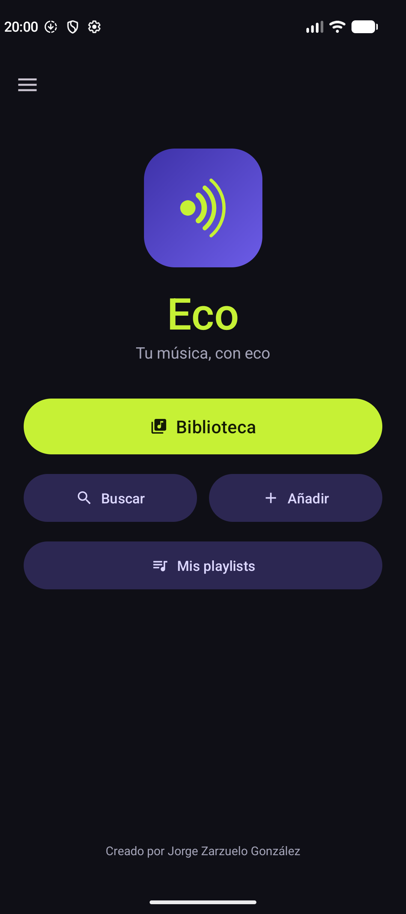
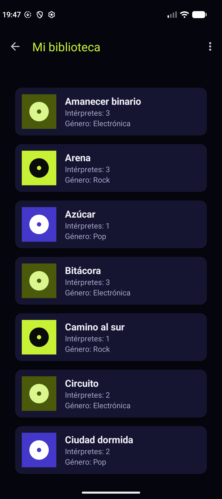
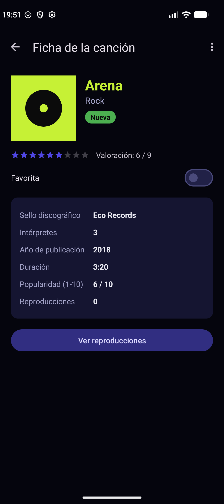
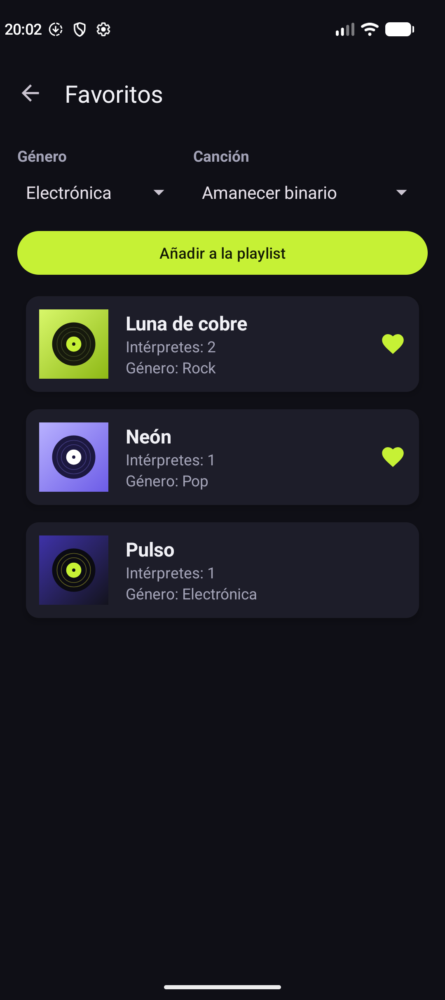
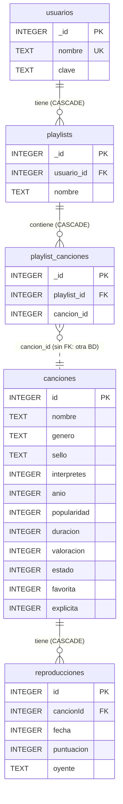
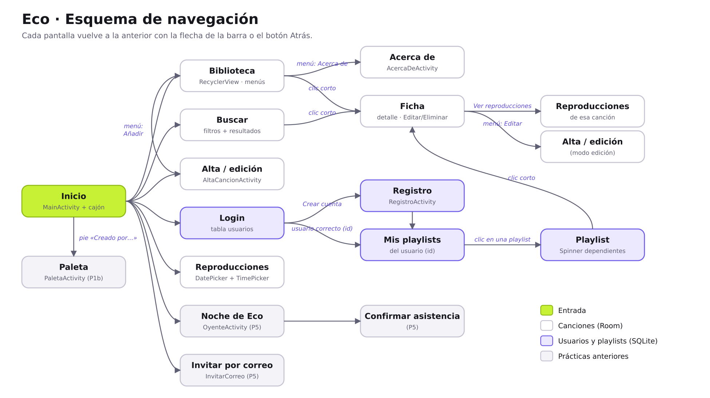

<p align="center">
  
</p>

<h1 align="center">Eco</h1>

<p align="center">
  <b>Tu música, con eco.</b><br>
  Biblioteca musical para Android en Java · Proyecto de la 1.ª evaluación de PMDM<br>
  2.º DAM · IES Claudio Moyano (Zamora) · Curso 2026-27
</p>

<p align="center">
  
  
  
  
</p>

---

## Qué es

Eco es una app para guardar y organizar canciones, inspirada en Spotify:

- **Biblioteca** de canciones con portada por género, ficha completa, alta, edición y borrado.
- **Valoración** con estrellas, **estado** de escucha (Nueva / Escuchada / En bucle), **favorita** y **contenido explícito**.
- **Reproducciones**: registra cuándo escuchas una canción (fecha y hora con DatePicker y TimePicker), quién y qué puntuación le das.
- **Playlists personales**: cada usuario inicia sesión (o se registra) y tiene sus propias playlists.
- **Búsqueda** por nombre (empieza por / contiene) y valoración mínima, y **ordenación** por nombre.
- Tema **claro y oscuro**, en **español e inglés**, y pantallas preparadas para **girar el móvil**.

## Cómo ejecutarla

| Requisito | Versión |
|-----------|---------|
| Android Studio | una versión reciente compatible con AGP 9.5 |
| JDK | el JBR que trae Android Studio (Java 21) |
| Android Gradle Plugin | 9.5.1 |
| SDK | `compileSdk` y `targetSdk` 37 · `minSdk` 29 (Android 10) |

1. Clona el repositorio:
   ```bash
   git clone https://github.com/JorgeZarzueloGonzalez/eco-app.git
   ```
2. Ábrelo en Android Studio (**File → Open** → carpeta `eco-app`) y espera a que termine el *Gradle Sync*.
3. Elige un emulador o un móvil con Android 10 o superior y pulsa **Run ▶**.

Desde la terminal también se puede compilar el APK de depuración:

```bash
./gradlew assembleDebug        # app/build/outputs/apk/debug/app-debug.apk
```

### Credenciales de prueba

| Usuario | Contraseña | Playlist de ejemplo |
|---------|------------|---------------------|
| `admin` | `admin` | Favoritos (3 canciones) |
| `carlos` | `carlos` | Para correr (3 canciones) |

Desde el login también se pueden **crear cuentas nuevas**.

### Carga inicial

En una **instalación limpia**, la primera vez que se abre la app se cargan los datos de ejemplo:

- **2 usuarios** (los de la tabla de arriba) y una playlist para cada uno.
- **21 canciones** de tres géneros, algunas ya marcadas como favoritas o con estado.
- **3 reproducciones** (la relación 1-N de Room).

Es un punto de partida: todo se puede añadir, editar y borrar.

---

## Hitos

| Práctica | Qué se añadió | Commit |
|:--------:|---------------|:------:|
| P1b | Proyecto base, paleta de colores y contador | `4f2c845` |
| P2 | Pantalla de alta y contador de intérpretes | `73e9628` |
| P3 | Validación de la popularidad, estado con colores y teclado de valoración | `cbc23d5` |
| P4 | Formulario completo, validaciones y ficha de la canción | `9f06331` |
| P5 | Asistencia a la Noche de Eco (resultado entre pantallas) e invitación por correo | `cb3e974` |
| P6 | Intents implícitos: web, WhatsApp y Drag & Drop | `3fc68a5` |
| P7 | Buscador con Spinner dependientes | `4aa1db7` |
| P8 | Modelo `Cancion`, biblioteca y adaptador propio | `49984c0` |
| P9 | `RecyclerView` con `CardView` | `0bdf676` |
| — | Traducción al inglés | `6570ee6` |
| P11 | Toolbar, menú de opciones, menú contextual y Navigation Drawer | `1af5115` |
| P12 | SQLite: canciones, login y lista de favoritos | `1b5afb8` |
| P13 | Room: canciones y reproducciones con migración desde SQLite | `d67fa47` |
| Proyecto | Pantalla de inicio, logo e icono | `ff9c5c5` |
| Proyecto | Estado, favorita y explícita (Room v2); ficha nueva; DialogFragment de fecha y hora | `f73e6bb` |
| Proyecto | Playlists por usuario (SQLite v3) y registro | `d846016` |
| Proyecto | Idiomas completos y limpieza de recursos | `c708764` |
| Proyecto | Barra con vuelta en todas las pantallas y Acerca de | `186ee0c` |
| Proyecto | Paleta nueva para tema claro y oscuro | `695027c` |

---

## Bases de datos

La app usa **dos bases de datos a la vez**, como pide el enunciado:

| Base de datos | Tecnología | Versión | Tablas |
|---------------|-----------|:-------:|--------|
| `eco.db` | SQLite (`EcoDB`, `SQLiteOpenHelper`) | 3 | `usuarios`, `playlists`, `playlist_canciones` |
| `eco_room.db` | Room (`AppDatabase`) | 2 | `canciones`, `reproducciones` |



Puntos clave (más detalle en el manual técnico):

- **Todas las consultas van fuera del hilo principal**, en `AppDatabase.executor` (un único hilo), y la interfaz se actualiza con `runOnUiThread`.
- **CASCADE**: borrar una canción borra sus reproducciones; borrar un usuario borra sus playlists y, con ellas, sus canciones de playlist.
- `playlist_canciones.cancion_id` apunta a Room, que es **otra base de datos**: no puede llevar clave ajena. Las canciones borradas se limpian de las playlists al abrirlas.
- **Migraciones sin perder datos**:
  - `EcoDB` 1 → 2 → 3: los favoritos de la P12 pasan a una playlist «Favoritos».
  - Room 1 → 2: tres columnas nuevas (`estado`, `favorita`, `explicita`).
  - Copia única de las canciones de SQLite a Room, conservando el `id`.

Esquema completo: [`docs/esquema-bd.png`](docs/esquema-bd.png)

---

## Navegación



| Pantalla | Activity | Qué se hace |
|----------|----------|-------------|
| Inicio | `MainActivity` | Accesos principales y menú lateral |
| Biblioteca | `BibliotecaActivity` | Lista de canciones; menú Añadir / Ordenar / Acerca de; menú contextual Editar / Eliminar |
| Ficha | `FichaCancionActivity` | Detalle, favorita, Editar / Eliminar y reproducciones |
| Alta / edición | `AltaCancionActivity` | Formulario con validaciones |
| Buscar | `BuscarActivity` | Filtros por nombre y valoración |
| Reproducciones | `ReproduccionActivity` | CRUD de reproducciones con fecha y hora |
| Login | `LoginActivity` | Identifica al usuario contra la tabla `usuarios` |
| Registro | `RegistroActivity` | Crea un usuario |
| Mis playlists | `PlaylistsActivity` | Playlists del usuario; cambiar contraseña, cerrar sesión, borrar cuenta |
| Playlist | `PlaylistActivity` | Canciones de una playlist; añadir con Spinner dependientes |
| Acerca de | `AcercaDeActivity` | Versión, autor y repositorio |
| Noche de Eco · Confirmar · Invitar · Paleta | prácticas 1b y 5 | Se conservan del curso |

---

## Estructura del código

```
app/src/main/java/es/ies/cm/dam2/pmdm/eco/
├── data/
│   ├── room/      AppDatabase, CancionDao, ReproduccionDao, MigracionInicial
│   └── sqlite/    EcoDB (usuarios y playlists)
├── model/         Cancion, Reproduccion, Usuario, Playlist
├── ui/
│   ├── activities/   las 15 pantallas
│   ├── adapters/     AdaptadorCancionRecycler, AdaptadorPlaylist, AdaptadorReproduccion
│   └── dialogs/      ConfirmarDialogFragment, FechaDialogFragment, HoraDialogFragment, TextoDialogFragment
└── util/          Formatos, Pantallas, Portadas
```

## Documentación

| Qué | Dónde |
|-----|-------|
| Capturas de todas las pantallas (también en claro, en horizontal y en inglés) | [`docs/capturas/`](docs/capturas) |
| Esquema de las bases de datos | [`docs/esquema-bd.png`](docs/esquema-bd.png) |
| Esquema de navegación | [`docs/navegacion.png`](docs/navegacion.png) |
| Manual de usuario y manual técnico (PDF) | Se entregan aparte, junto con el proyecto |

## Autor

**Jorge Zarzuelo González** · 2.º DAM · IES Claudio Moyano (Zamora)<br>
Programación Multimedia y Dispositivos Móviles · Curso 2026-27
